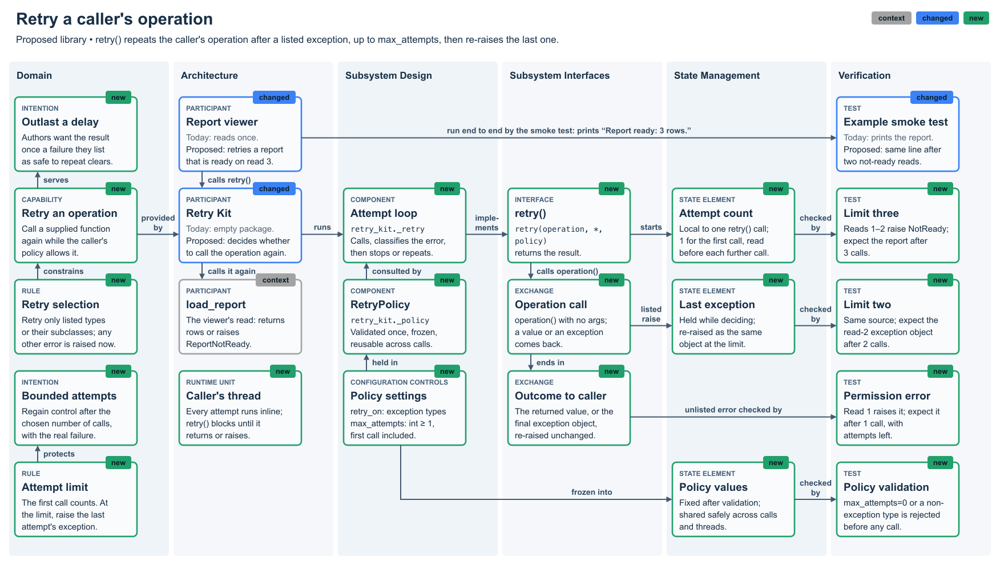
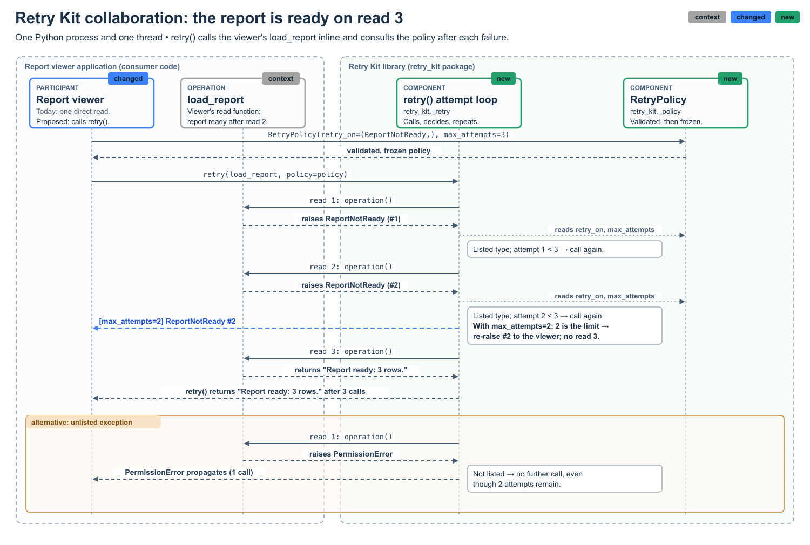
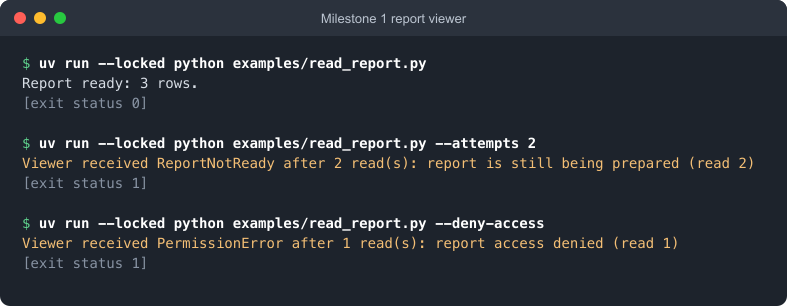
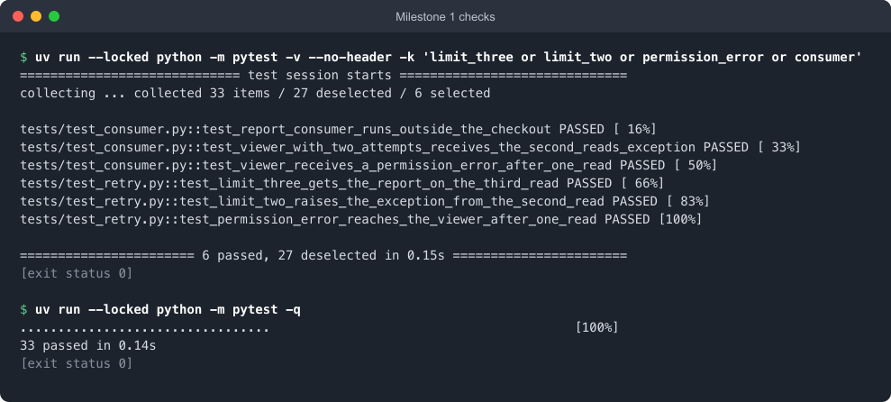

# Milestone 1: Retry a caller’s operation

*Claude Code build.* [Recording index](README.md) · Baseline: the shared starter

**How to read this chapter.** Plain text is editorial. Quoted blocks reproduce the Claude Code responses, edited for publication. File paths refer to the milestone being described.

## Prompt

The first prompt from the [build guide](../build-prompts.md#1-retry-a-callers-operation) uses the Claude Code command `/ca-design-proposal`.

```text
I'd like to build Retry Kit, a small Python library for developers who need to
retry a synchronous operation. For example, a report viewer might retry a read
while a report is still being prepared. A client fetching a record might try
again after a connection drops. I'd like the library to be used for such cases.

Each caller knows the exceptions that determine when it's safe to repeat the
operation and provides a list of such exceptions to the library. The caller
should also choose how many attempts to allow, counting the first call. The
library should retry the operation only if the called function raises one of
those exceptions.

Take the report viewer as an example. Its read function may raise ReportNotReady
if the report is still being prepared. Depending on the time taken to prepare
the report, sometimes the first read succeeds, and sometimes it takes a few
tries. Say the report becomes available between the second and third retries.
With a limit of three attempts, the viewer should get the report eventually.
With a limit of two, it should get the ReportNotReady exception from its
second read. A permission error should reach the viewer immediately.

Give me a design proposal [use /ca-design-proposal].
```

## Design proposal (recorded)

The proposal compares the requested change with the shared starter. The editable design figures are the [overview](assets/milestone-1/diagrams/overview.svg) and the [collaboration diagram](assets/milestone-1/diagrams/collaboration.svg).

> Application authors such as the report viewer's need a reusable way to repeat a synchronous operation after failures they know are safe to repeat, so they get the result once the failure clears and get control back, with the real failure, after a number of attempts they choose.
>
> 
>
> **Baseline.** At the shared starter, `retry_kit` is an importable package whose `__init__.py` holds only a docstring. `examples/read_report.py` reads the report once and prints `Report ready: 3 rows.`, and `tests/test_consumer.py` runs that example in a subprocess. There is no retry behavior to compare against, so most subjects below are new.
>
> **Assumption to confirm.** The request says the report "becomes available between the second and third retries", but the expected outcomes (limit three succeeds, limit two raises from the second read) only hold if it becomes available between the second and third *reads*. I've used that reading throughout: reads 1 and 2 raise `ReportNotReady`, read 3 returns the report.
>
> ## Domain
>
> **Intentions.** Two independent effects: *outlast a delay* (get the operation's result once a failure the caller listed as safe to repeat clears) and *bounded attempts* (regain control after the chosen number of calls, holding the failure that actually happened). The capability serving both is **retry an operation**: call a caller-supplied function again while the caller's policy allows it.
>
> **Rules.** *Retry selection* constrains the capability: only an exception whose type is listed, or a subclass of a listed type, leads to another call; any other exception (the viewer's `PermissionError`) propagates from the call that raised it. *Attempt limit* protects bounded attempts: the first call counts, so `max_attempts=3` means at most three calls, and when the last allowed call fails with a listed exception, the caller receives that exception object itself, not a wrapper. The request settles the wrapper question ("it should get the ReportNotReady exception from its second read").
>
> **One open rule: subclass matching.** Suppose the viewer lists `ReportNotReady`, and read 1 raises `ReportStillRendering`, a subclass of it.
>
> | Matching rule | What the viewer observes |
> | --- | --- |
> | Listed type or subclass (`isinstance`) | Read 2 happens; the viewer gets the report if it's ready. |
> | Exact type only | `ReportStillRendering` reaches the viewer after one read. |
>
> I recommend subclass matching. It's how Python's own `except` clause behaves, so a caller listing a base class gets what they'd expect from writing the loop themselves; the cost is that a caller wanting to exclude one subclass must list narrower types.
>
> ## Architecture
>
> **Participants.** The *report viewer* (consumer, `examples/read_report.py`) today calls `load_report` directly once; it will instead pass `load_report` and a policy to Retry Kit. *Retry Kit* today offers no behavior; it will own the decision whether to call again. `load_report` remains the viewer's function; Retry Kit calls it back but doesn't know what it reads.
>
> **Runtime units.** Everything runs in the caller's thread. `retry()` calls the operation inline and blocks until it returns or raises; it creates no threads and catches only the listed types, so `KeyboardInterrupt` and unlisted errors pass straight through.
>
> 
>
> The sequence follows the viewer's case: the policy is validated once at construction; the attempt loop calls `load_report`, consults the policy after each failure, and returns the third read's value. With `max_attempts=2` it re-raises the second `ReportNotReady` instead of making read 3.
>
> ## Subsystem Design
>
> Package `src/retry_kit/`:
>
> | Package or module | Components | Today → Proposed responsibility |
> | --- | --- | --- |
> | `__init__.py` `changed` | Public surface | Docstring only → exports `retry` and `RetryPolicy`. |
> | `_policy.py` `new` | **RetryPolicy** | None → validates and holds the caller's choices; frozen dataclass, reusable. |
> | `_retry.py` `new` | **Attempt loop** | None → calls the operation, classifies a raised exception against the policy, returns, repeats or re-raises. |
> | `examples/read_report.py` `changed` | Report viewer example | One direct read → a report source that is still preparing for two reads, read through `retry()` with three attempts. Output stays `Report ready: 3 rows.` |
>
> **Configuration controls.** `retry_on` (exception types that justify another call) and `max_attempts` (total calls, first included). `retry_on` accepts any iterable such as a list and is stored as a tuple; it must be non-empty and contain only `Exception` subclasses. `max_attempts` must be an `int` ≥ 1 (`bool` rejected). Invalid values raise `TypeError` or `ValueError` when the policy is built, before any call.
>
> ## Subsystem Interfaces
>
> New public interfaces, imported from `retry_kit`:
>
> ```python
> policy = RetryPolicy(retry_on=[ReportNotReady], max_attempts=3)
> report = retry(load_report, policy=policy)
> ```
>
> **Operation call.** `retry()` calls `operation()` with no arguments; callers bind arguments with a lambda or `functools.partial`. **Outcome to caller.** The first returned value, unchanged; or the final listed exception re-raised as the same object with its traceback; or an unlisted exception from whichever call raised it.
>
> ## State Management
>
> **Attempt count** is local to one `retry()` call: 1 for the first call, compared with `max_attempts` before each further call. **Last exception** is held only while deciding, then re-raised. **Policy values** are fixed after validation, so one policy can be shared across calls and threads. Nothing persists between `retry()` calls.
>
> ## Verification
>
> All proposed checks run with `uv run --locked python -m pytest -q`. The scripted report source is a test fake that raises `ReportNotReady` for reads 1–2 and counts calls; it substitutes only for `load_report`, so the real attempt loop is exercised through the public `retry()`.
>
> | Tests | Expected assertion | Status |
> | --- | --- | --- |
> | Report viewer acceptance `[component]` | Limit 3: report returned, 3 calls. Limit 2: raises the read-2 `ReportNotReady` (`is` that object), 2 calls. `PermissionError` on read 1: raised after 1 call. | proposed |
> | Retry selection details `[component]` | First read succeeds → 1 call; listed subclass is retried; unlisted error isn't. | proposed |
> | Policy validation `[unit]` | `max_attempts` of 0 or `True`, empty `retry_on`, non-exception entries are rejected; operation never called. | proposed |
> | Example smoke test `[end-to-end]` | Still prints exactly `Report ready: 3 rows.` with empty stderr, now after two not-ready reads. | existing, changed fixture |
>
> Plausible failures these expose: an off-by-one that allows a third read under limit two (limit-two call count becomes 3); a broad `except Exception` (permission-error call count exceeds 1); wrapping the final error (identity assertion fails).
>
> **Approve or revise?** In particular, confirm (1) the reads-not-retries reading of the example and (2) subclass matching for `retry_on`. Once approved, I'll implement this milestone and run its checks.

## Authorization to implement

The build instruction gave standing authorization to implement each completed proposal. Claude Code recorded the choices it adopted before implementation.

> *Proceeding under the standing authorization in your instructions to implement each completed proposal without a separate approval; I'm adopting both recommendations above (reads-not-retries, subclass matching).*

## Implementation report (recorded)

Claude Code reported these results after implementing the milestone and running its checks.

> Milestone 1 is implemented as proposed and committed on `claude` (“Implement milestone 1: retry a caller's operation”).
>
> **What changed**
>
> - `src/retry_kit/_policy.py` adds `RetryPolicy(*, retry_on, max_attempts)`, a frozen dataclass. `retry_on` accepts any iterable of `Exception` subclasses and is stored as a tuple; `max_attempts` must be an `int` ≥ 1. Invalid values raise `TypeError` or `ValueError` at construction.
> - `src/retry_kit/_retry.py` adds `retry(operation, *, policy)`. It calls `operation()` inline, catches only `policy.retry_on` (so listed subclasses match), calls again while `attempt < max_attempts`, and otherwise re-raises with a bare `raise`, so the caller gets the same exception object. The attempt count is a local variable; nothing persists between calls.
> - `src/retry_kit/__init__.py` exports `retry` and `RetryPolicy`.
> - `examples/read_report.py` now reads a report that is still being prepared for two reads, through `retry()` with three attempts. Its default output is unchanged (`Report ready: 3 rows.`), so the README's run instructions still hold.
>
> **One addition beyond the proposal:** the example takes `--attempts N` and `--deny-access` so the limit-two and permission-error outcomes can be tried in the running example. On those paths the viewer prints which exception it received, after how many reads, to stderr and exits 1. This touches only the example, not the library's design.
>
> **Checks run**
>
> `uv run --locked python -m pytest -q` → **33 passed**.
>
> | Tests | Result |
> | --- | --- |
> | Report viewer acceptance `[component]` (`tests/test_retry.py`) | Limit 3 returns the report after 3 reads; limit 2 raises the read-2 `ReportNotReady` (same object) after 2 reads; `PermissionError` raised after 1 read. Passed. |
> | Retry selection details `[component]` | First-read success makes 1 call and returns the value unchanged; listed subclass retried; base of a listed type not retried; unlisted error after a retry propagates from that read; several listed types; limit 1; one policy reused gives each call its own count; final exception has no `__context__`/`__cause__`. Passed. |
> | Policy validation `[unit]` | Bad `max_attempts` (0, -1, `True`, 2.0, "3", `None`) and bad `retry_on` (empty, bare class, string, `None`, non-class entries, instance, `KeyboardInterrupt`, `int`) rejected; keyword-only; frozen; `retry()` rejects a non-callable operation and a non-policy without calling. Passed. |
> | Example `[end-to-end]` (`tests/test_consumer.py`) | Default run prints exactly `Report ready: 3 rows.` with empty stderr; `--attempts 2` and `--deny-access` report the read-2 `ReportNotReady` and read-1 `PermissionError` with exit 1. Passed. |
>
> **Acceptance scenario in the running example**
>
> ```text
> $ uv run --locked python examples/read_report.py
> Report ready: 3 rows.
> $ uv run --locked python examples/read_report.py --attempts 2
> Viewer received ReportNotReady after 2 read(s): report is still being prepared (read 2)
> $ uv run --locked python examples/read_report.py --deny-access
> Viewer received PermissionError after 1 read(s): report access denied (read 1)
> ```
>
> **Limits of this verification:** sharing one policy across threads is supported by design (frozen policy, per-call local state), but no test runs concurrent threads. The tests' scripted report is a stand-in for `load_report`; the attempt loop and policy are the real code.

## Terminal captures of the working library

These captures show the report viewer and tests from the milestone 1 implementation. The images render the commands, exit statuses, and terminal output. Each has a plain-text transcript.

### 1. Three reads, two reads, and a permission error

([transcript](assets/milestone-1/screenshots/01-report-viewer.txt), [SVG](assets/milestone-1/screenshots/01-report-viewer.svg))



### 2. Bounded-retry checks

([transcript](assets/milestone-1/screenshots/02-tests.txt), [SVG](assets/milestone-1/screenshots/02-tests.svg))



## Navigation

[Next milestone](milestone-2-let-callers-choose-how-long-to-wait.md) · [Recording index](README.md) · [Build prompts](../build-prompts.md) · [Project README](../../README.md)
