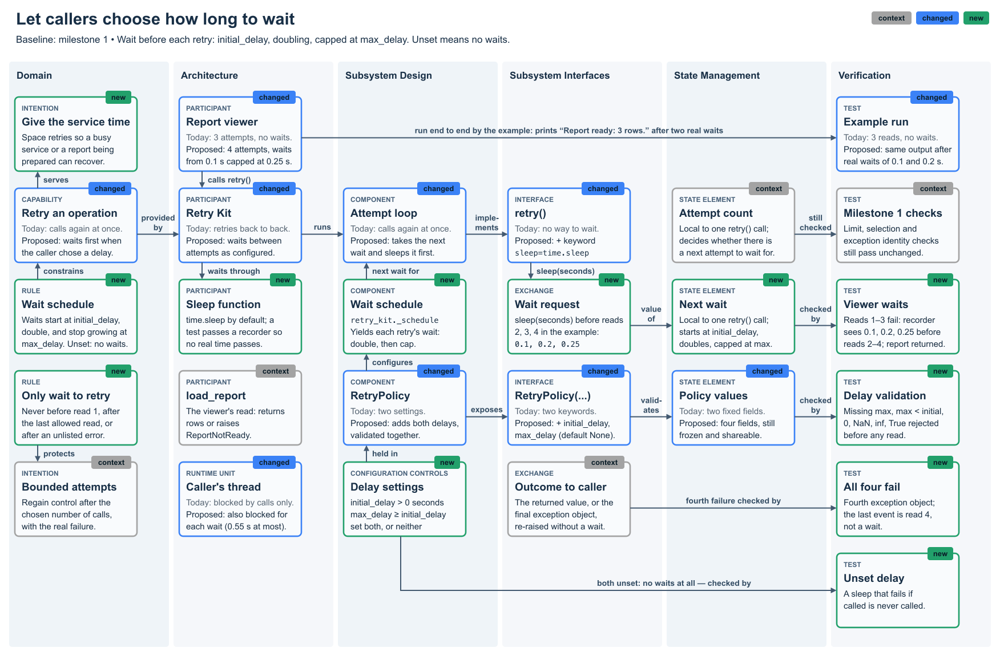
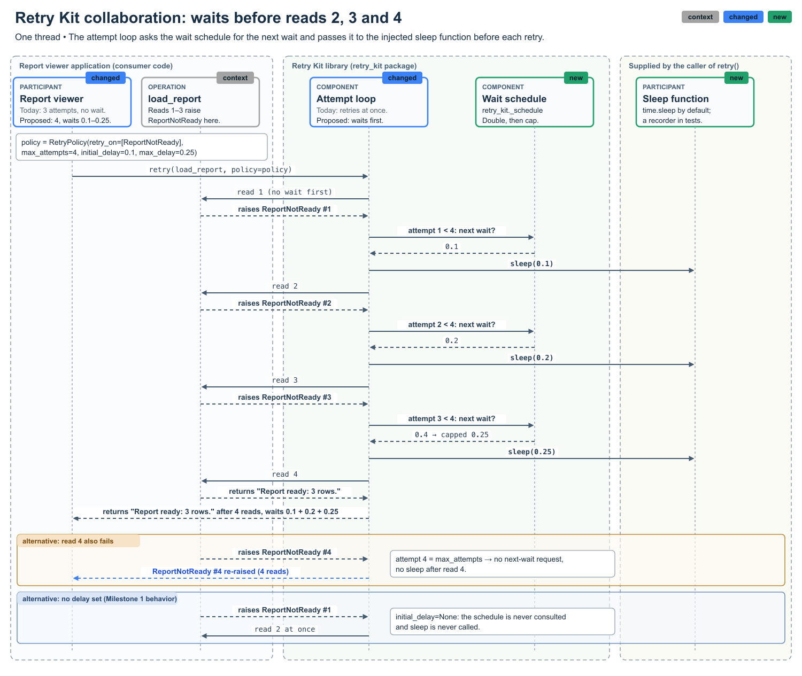
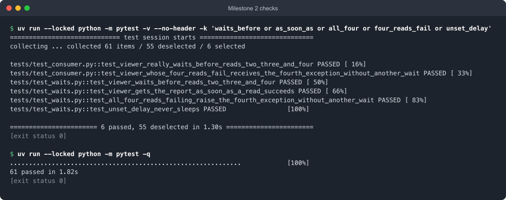

# Milestone 2: Let callers choose how long to wait

*Claude Code build.* [Recording index](README.md) · Baseline: [milestone 1](milestone-1-retry-a-callers-operation.md)

**How to read this chapter.** Plain text is editorial. Quoted blocks reproduce the Claude Code responses, edited for publication. File paths refer to the milestone being described.

## Prompt

The second prompt from the [build guide](../build-prompts.md#2-let-callers-choose-how-long-to-wait) uses the Claude Code command `/ca-design-proposal`.

```text
I'd like callers to be able to choose how long Retry Kit waits between
attempts. A client fetching a record might give a busy service time to
recover. The first call should still start right away. If a caller chooses
an initial delay, each successive wait should double up to a maximum the
caller sets. Callers who leave the delay unset should still get immediate
retries.

Take the report viewer as an example. It allows four reads and chooses an
initial delay of 0.1 seconds and a maximum of 0.25 seconds. If the first
three reads raise ReportNotReady, I'd expect the viewer to wait 0.1, 0.2,
and 0.25 seconds before reads two, three, and four. As soon as a read
succeeds, the viewer should get the report. If all four reads fail, it
should get the fourth exception without another wait. I'd like to check
those waits without sleeping in a test.

Give me a design proposal [use /ca-design-proposal].
```

## Design proposal (recorded)

The proposal compares the requested change with [milestone 1](milestone-1-retry-a-callers-operation.md). The editable design figures are the [overview](assets/milestone-2/diagrams/overview.svg) and the [collaboration diagram](assets/milestone-2/diagrams/collaboration.svg).

> Callers retrying against something that needs time to recover, such as a busy record service or a report still being prepared, need Retry Kit to space its attempts by a schedule they choose, while callers who choose no delay keep today's immediate retries.
>
> 
>
> **Baseline.** I compared against the milestone 1 implementation on `claude`. In `_retry.py`, after a listed exception with attempts left, the loop increments `attempt` and calls the operation again immediately. `RetryPolicy` holds only `retry_on` and `max_attempts`. The example viewer in `examples/read_report.py` allows three attempts and never waits.
>
> ## Domain
>
> **Intentions.** New: *give the service time*, spacing retries so whatever made the operation fail can recover. Retained as context: *bounded attempts*, which the request's "fourth exception without another wait" serves.
>
> **Capability.** *Retry an operation* changes from "call again at once" to "wait first, if the caller chose a delay".
>
> **Rules.** *Wait schedule*: the wait before retry *n* is `initial_delay × 2ⁿ⁻¹`, capped at `max_delay`; for the viewer that's 0.1, 0.2, then 0.4 capped to 0.25. With no delay set there are no waits at all. *Only wait to retry*: a wait happens only when another call will follow. So there's none before read 1, none after the last allowed read, and none after an unlisted exception, which still propagates immediately.
>
> **Open rule: is `max_delay` required?** "Double up to a maximum the caller sets" doesn't say what happens if the caller sets only `initial_delay`. Take `initial_delay=0.1`, `max_attempts=12` and an operation that keeps failing:
>
> | Rule | What the caller observes |
> | --- | --- |
> | `max_delay` required with `initial_delay` | `RetryPolicy(...)` raises `ValueError` before any call. |
> | Unbounded doubling | The 11th wait is 102.4 s; the thread blocks about 205 s in total before the 12th exception. |
>
> I recommend requiring it. Exponential growth turns a small attempt count into a long block, and the request frames the maximum as the caller's choice. Setting `max_delay` without `initial_delay` is rejected for the same reason: it would have no effect.
>
> ## Architecture
>
> **Retry Kit** today retries back to back; it will wait between attempts as configured. A new **sleep function** participates: `time.sleep` by default, or a recorder supplied by a test, so the waits can be checked without real time passing. **Runtime units:** the caller's thread, which today blocks only while the operation runs, will also block for each wait. For the viewer that's at most 0.55 s in total. Retry Kit still creates no threads.
>
> 
>
> After each listed failure with attempts left, the attempt loop takes the next wait from the schedule and passes it to the sleep function before the next read. On the final failure it makes no wait request at all.
>
> ## Subsystem Design
>
> Package `src/retry_kit/`:
>
> | Package or module | Components | Today → Proposed responsibility |
> | --- | --- | --- |
> | `_retry.py` `changed` | **Attempt loop** | Calls again at once → when a delay is set, gets the next wait and calls `sleep(wait)` before the next call. The sleep happens outside the `except` block, so the failed attempt's exception isn't held during the wait. |
> | `_schedule.py` `new` | **Wait schedule** | None → `waits(initial, maximum)` yields `initial`, then repeatedly `min(previous × 2, maximum)`. |
> | `_policy.py` `changed` | **RetryPolicy** | Validates two settings → also validates the two delays together. |
> | `examples/read_report.py` `changed` | Report viewer example | Three attempts, no waits → the viewer's policy (four attempts, 0.1 s, 0.25 s). `--not-ready-reads N` sets how many reads fail, and `--show-waits` prints each real wait to stderr. Default output is still `Report ready: 3 rows.` |
>
> **Configuration controls.** `initial_delay` and `max_delay`, in seconds, both default `None`. When set, both must be finite real numbers (not `bool`), `initial_delay > 0` and `max_delay ≥ initial_delay`; otherwise `ValueError` or `TypeError` is raised at construction. `0` is rejected rather than meaning "immediate"; leaving the delay unset already means immediate.
>
> ## Subsystem Interfaces
>
> Both changes add optional keywords, so every Milestone 1 call keeps working unchanged:
>
> ```python
> policy = RetryPolicy(retry_on=[ReportNotReady], max_attempts=4,
>                      initial_delay=0.1, max_delay=0.25)
> report = retry(load_report, policy=policy, sleep=time.sleep)  # sleep is the default
> ```
>
> **Wait request.** `sleep(seconds)` receives a float, and its return value is ignored. If it raises (for example `KeyboardInterrupt` during a wait), that exception propagates and no further call is made. I put `sleep` on `retry()` rather than the policy because it's an environment dependency rather than a caller's retry choice, and it keeps the policy plain, shareable data.
>
> ## State Management
>
> **Next wait** (new) is local to one `retry()` call. It starts at `initial_delay` and doubles after each wait, capped at `max_delay`. Doubling a float is exact, so the viewer's waits are exactly `[0.1, 0.2, 0.25]`; a read-only run confirmed `0.1 * 2 == 0.2`. **Attempt count** (context) still decides whether a wait happens. **Policy values** grow to four fields, still frozen and shareable.
>
> ## Verification
>
> Run with `uv run --locked python -m pytest -q`. Component tests pass a recording `sleep` that appends `wait <s>` to the same event log the scripted `load_report` appends `read <n>` to, so order is checked and no real time passes.
>
> | Tests | Expected assertion | Status |
> | --- | --- | --- |
> | Viewer waits `[component]` | Reads 1–3 fail: log is `read 1, wait 0.1, read 2, wait 0.2, read 3, wait 0.25, read 4`, report returned. Success on read 2: `read 1, wait 0.1, read 2`. | proposed |
> | All four fail `[component]` | Raises read 4's exception object; log ends `read 4` (no wait after). | proposed |
> | Unset delay and unlisted errors `[component]` | A `sleep` that fails if called is never called with no delay set, or after a `PermissionError`. | proposed |
> | Wait schedule `[unit]` | `waits(0.1, 0.25)` yields 0.1, 0.2, 0.25, 0.25; equal delays stay constant. | proposed |
> | Delay validation `[unit]` | Only one delay set, `max < initial`, 0, negative, NaN, inf, `True` are rejected before any call. | proposed |
> | Milestone 1 checks `[component]`/`[unit]` | All pass unchanged. | existing |
> | Example `[end-to-end]` | Default prints `Report ready: 3 rows.`; `--not-ready-reads 3 --show-waits` shows real waits 0.1, 0.2, 0.25 then the report; `--not-ready-reads 4` reports read 4's `ReportNotReady`. | existing, extended |
>
> The end-to-end runs use real `time.sleep` (under 1.5 s in total), confirming that the default sleep is actually called. Plausible failures: a wait after the final read (log ends with a wait), doubling before the first wait (log shows 0.2 first), or calling `sleep(0)` when unset (the failing sleep trips).
>
> **Approve or revise?** Please confirm (1) that `max_delay` is required whenever `initial_delay` is set, and (2) that the sleep function is a `retry()` keyword rather than a policy field. Once approved, I'll implement this milestone and run its checks.

## Authorization to implement

The build instruction gave standing authorization to implement each completed proposal. Claude Code recorded the choices it adopted before implementation.

> *Proceeding under the standing authorization to implement each completed proposal without a separate approval; I'm adopting both recommendations above (`max_delay` required with `initial_delay`, `sleep` as a `retry()` keyword).*

## Implementation report (recorded)

Claude Code reported these results after implementing the milestone and running its checks.

> Milestone 2 is implemented as proposed and committed on `claude` (“Implement milestone 2: let callers choose how long to wait”), on top of Milestone 1.
>
> **What changed**
>
> - `src/retry_kit/_schedule.py` (new) adds `waits(initial, maximum)`, an endless generator: `initial`, then `min(previous * 2, maximum)`.
> - `src/retry_kit/_policy.py`: `RetryPolicy` gains keyword-only `initial_delay` and `max_delay` (default `None`). They must be set together. When set, both must be finite real numbers, not `bool`, and are stored as `float`; `initial_delay` must be greater than 0 and `max_delay` at least `initial_delay`. Violations raise `ValueError` or `TypeError` at construction.
> - `src/retry_kit/_retry.py`: `retry()` gains `sleep=time.sleep`. When the policy sets a delay, the loop creates a fresh schedule per call and, after a listed failure with attempts left, calls `sleep(next(schedule))` before the next call. The sleep sits after the `except` block, so nothing raised during a wait is chained to the failed attempt. No delay means no schedule and no `sleep` call at all.
> - `examples/read_report.py`: the viewer now uses `max_attempts=4, initial_delay=0.1, max_delay=0.25`, and adds `--not-ready-reads N` and `--show-waits`. The `--show-waits` output comes from a `sleep` wrapper that prints the wait and then calls `time.sleep`. Default output is still `Report ready: 3 rows.`, now after real waits of 0.1 s and 0.2 s.
>
> No departures from the approved design. Both recommendations were adopted: `max_delay` is required with `initial_delay`, and `sleep` is a `retry()` keyword.
>
> **Checks run**
>
> `uv run --locked python -m pytest -q` → **61 passed** (33 from Milestone 1, unchanged, plus 28 new).
>
> | Tests | Result |
> | --- | --- |
> | Viewer waits `[component]` (`tests/test_waits.py`) | Reads 1–3 fail: waits exactly `[0.1, 0.2, 0.25]`, event log `read 1, wait 0.1, read 2, wait 0.2, read 3, wait 0.25, read 4`, report returned. One failure: `read 1, wait 0.1, read 2`. First-read success: `read 1` only. Passed. |
> | All four fail `[component]` | Raises read 4's exception object; last event `read 4`; waits stay `[0.1, 0.2, 0.25]`. Passed. |
> | Unset delay and unlisted errors `[component]` | A `sleep` that fails if called is never called with no delay set, or after a `PermissionError` on read 1. A `PermissionError` after a retry stops at `read 2` with no further wait. Passed. |
> | Schedule details `[component]` | Waits hold at the maximum (`0.1, 0.2, 0.25, 0.25, 0.25`); each `retry()` call restarts at 0.1; whole-second settings are slept as floats; an exception from `sleep` propagates after one read with no `__context__`; a non-callable `sleep` is rejected before any read. Passed. |
> | Wait schedule `[unit]` | `waits(0.1, 0.25)` → `0.1, 0.2, 0.25, 0.25`; `waits(0.5, 0.5)` is constant. Passed. |
> | Delay validation `[unit]` | Defaults are `None`; a `Fraction` is stored as float; one delay alone, `max < initial`, 0, negative, NaN, inf, `True` and strings are rejected. Passed. |
> | Example `[end-to-end]` (`tests/test_consumer.py`) | Default output unchanged; `--not-ready-reads 3 --show-waits` prints the three waits, returns the report, and takes at least 0.55 s; `--not-ready-reads 4 --show-waits` prints the same three waits and then read 4's `ReportNotReady`. Milestone 1's `--attempts 2` and `--deny-access` checks still pass. Passed. |
>
> **Acceptance scenario in the running example**
>
> ```text
> $ uv run --locked python examples/read_report.py --not-ready-reads 3 --show-waits
> Waiting 0.1 s before read 2
> Waiting 0.2 s before read 3
> Waiting 0.25 s before read 4
> Report ready: 3 rows.
> $ uv run --locked python examples/read_report.py --not-ready-reads 4 --show-waits
> Waiting 0.1 s before read 2
> Waiting 0.2 s before read 3
> Waiting 0.25 s before read 4
> Viewer received ReportNotReady after 4 read(s): report is still being prepared (read 4)
> ```
>
> Timed with `/usr/bin/time`, both runs took about 0.65 s wall time against 0.55 s of requested waits. The all-fail run is no slower than the success run, which is consistent with no wait after read 4.
>
> **Limits of this verification:** the component tests check the requested waits, not real elapsed time. Real sleeping is covered only by the end-to-end runs, which check a lower bound on elapsed time, not an upper bound. Those runs request 1.5 s of waits in total (0.3 + 0.55 + 0.55 + 0.1), slightly more than the "under 1.5 s" I estimated in the proposal.

## Terminal captures of the working library

These captures show the report viewer and tests from the milestone 2 implementation. The images render the commands, exit statuses, and terminal output. Each has a plain-text transcript.

### 1. Capped waits before reads two, three, and four

([transcript](assets/milestone-2/screenshots/01-report-viewer.txt), [SVG](assets/milestone-2/screenshots/01-report-viewer.svg))


### 2. Wait-schedule checks

([transcript](assets/milestone-2/screenshots/02-tests.txt), [SVG](assets/milestone-2/screenshots/02-tests.svg))



## Navigation

[Previous milestone](milestone-1-retry-a-callers-operation.md) · [Recording index](README.md) · [Build prompts](../build-prompts.md) · [Project README](../../README.md)
