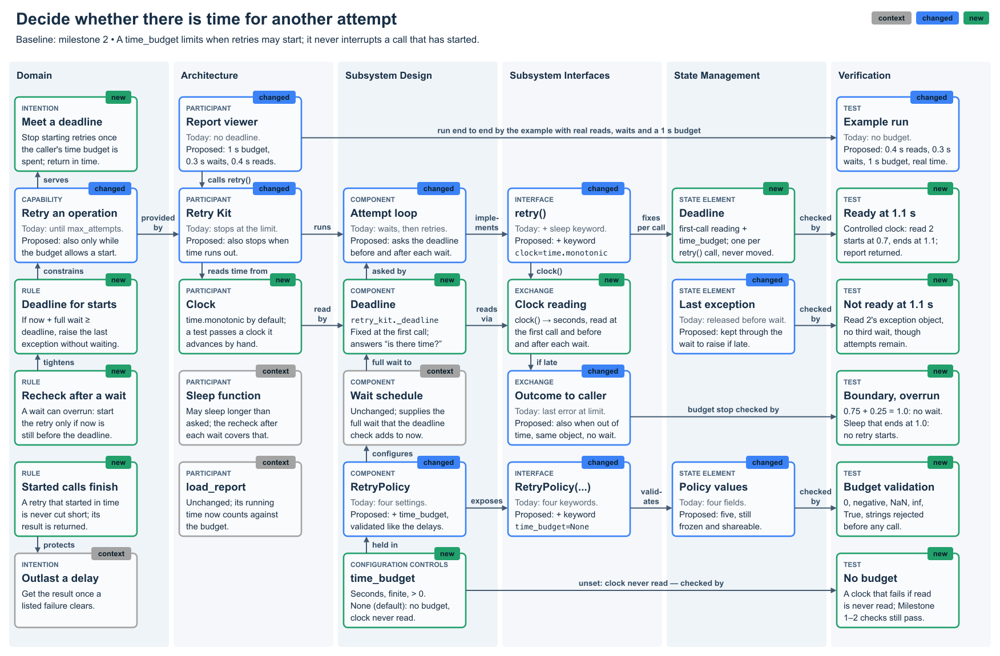
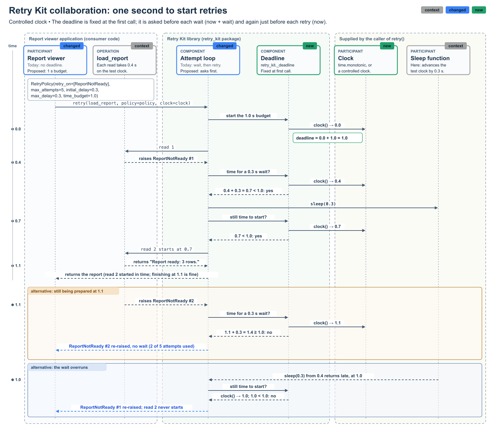
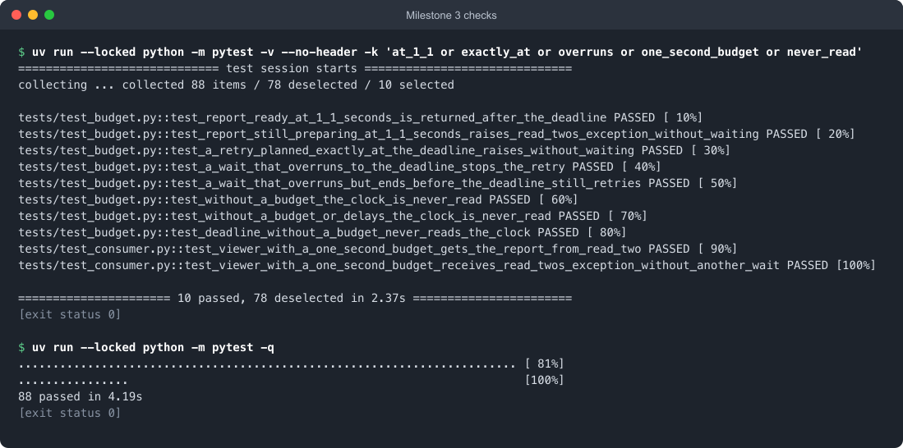

# Milestone 3: Decide whether there’s time for another attempt

*Claude Code build.* [Recording index](README.md) · Baseline: [milestone 2](milestone-2-let-callers-choose-how-long-to-wait.md)

**How to read this chapter.** Plain text is editorial. Quoted blocks reproduce the Claude Code responses, edited for publication. File paths refer to the milestone being described.

## Prompt

The third prompt from the [build guide](../build-prompts.md#3-decide-whether-theres-time-for-another-attempt) uses the Claude Code command `/ca-design-proposal`.

```text
I'd like callers who have a deadline to be able to set a time budget for
starting retries. Both the operation and the waits use up that budget. If the
full wait would put the next retry at or past the deadline, the library should
raise the last exception without waiting, even if the caller has attempts
left. A wait can also take longer than requested, so the library should
check that there's still time just before starting a retry.

Take the report viewer as an example. It has a one-second budget and waits
0.3 seconds between reads. Suppose its first read takes 0.4 seconds and
raises ReportNotReady. The second read starts at 0.7 seconds and finishes
at 1.1 seconds. If the report is ready then, the viewer should get it. If
it's still being prepared, the viewer should get the ReportNotReady exception
from that second read without another wait. I'd like to check both outcomes
with a clock we can control.

Give me a design proposal [use /ca-design-proposal].
```

## Design proposal (recorded)

The proposal compares the requested change with [milestone 2](milestone-2-let-callers-choose-how-long-to-wait.md). The editable design figures are the [overview](assets/milestone-3/diagrams/overview.svg) and the [collaboration diagram](assets/milestone-3/diagrams/collaboration.svg).

While drafting, the assistant found and fixed one incorrect claim before the response
was presented. The draft said that starting the budget at the first failure would make the
viewer’s not-ready case wait, but 1.1 + 0.3 equals that shifted deadline of 1.4, so it would not.
The presented response, recorded below, names the equality row as the check that exposes this.

> Callers working to a deadline, like a report viewer that must answer within a second, need Retry Kit to stop starting retries once their time budget can't cover the next one, while still delivering the result of a retry that started in time.
>
> 
>
> **Baseline.** I compared against the milestone 2 implementation on `claude`. After a listed exception with attempts left, `_retry.py` sleeps the next wait unconditionally and calls again; only `max_attempts` stops it. Nothing reads a clock. The failed attempt's exception is deliberately released before the wait. `RetryPolicy` has four settings.
>
> ## Domain
>
> **Intentions.** New: *meet a deadline*, so the caller gets control back in time rather than after every allowed attempt. Retained as context: *outlast a delay*, which the third rule below protects.
>
> **Capability.** *Retry an operation* changes from "until `max_attempts`" to "until `max_attempts`, and only while the budget allows a start".
>
> **Rules.**
> - *Deadline for starts.* The deadline is the clock reading at the first call plus `time_budget`; the example counts read 1's 0.4 s, so the budget starts there. After a listed failure, if now + the full wait ≥ deadline, raise that exception without waiting, even with attempts left.
> - *Recheck after a wait.* Waits can overrun, so just before each retry, start it only if now < deadline; otherwise raise the exception that preceded the wait.
> - *Started calls finish.* The budget never interrupts a running call. This answers the README's question: a retry that starts in time and succeeds after the deadline returns its result.
>
> At the boundary, using values that are exact in binary floating point (budget 1.0, wait 0.25):
>
> | Read 1 fails at | now + wait | Outcome |
> | --- | --- | --- |
> | 0.5 | 0.75 < 1.0 | Wait; read 2 starts at 0.75. |
> | 0.75 | 1.0, at the deadline | Raise read 1's exception, no wait. |
> | 0.5, but the sleep returns at 1.0 | recheck: 1.0 < 1.0 fails | Raise read 1's exception; read 2 never starts. |
>
> **Open rule: whose budget?** Take one policy reused for two reports. The second `retry()` call starts at 0.8 s, and its first read fails at 0.9 s with a 0.3 s wait.
>
> | Rule | What the viewer observes |
> | --- | --- |
> | Per-call `time_budget` on the policy | Deadline 1.8: it waits and retries. |
> | Absolute `deadline` passed to `retry()` and shared | Deadline 1.0: 1.2 ≥ 1.0, so it raises at once. |
>
> I recommend the per-call budget. It's what "set a time budget" describes, and it keeps a policy reusable. A caller with one fixed end-to-end deadline can build a policy from the remaining time.
>
> ## Architecture
>
> **Retry Kit** today stops only at the attempt limit; it will also stop when time runs out. A new **clock** participates: `time.monotonic` by default, or a clock a test advances by hand. The **sleep function** is unchanged, but its possible overrun is why the recheck exists. **Runtime units:** still the caller's thread. Because a running call is never interrupted, control can return as late as the deadline plus one call's duration.
>
> 
>
> Read 1 runs from 0.0 to 0.4; 0.4 + 0.3 = 0.7 < 1.0, so the loop waits. At 0.7 there's still time, so read 2 runs to 1.1. If read 2 fails, 1.1 + 0.3 ≥ 1.0 and its exception is raised with three attempts unused.
>
> ## Subsystem Design
>
> Package `src/retry_kit/`:
>
> | Package or module | Components | Today → Proposed responsibility |
> | --- | --- | --- |
> | `_deadline.py` `new` | **Deadline** | None → reads the clock once at the first call; answers `allows_wait(seconds)` (now + seconds < deadline) and `allows_start()` (now < deadline). With no budget it answers yes without reading the clock. |
> | `_retry.py` `changed` | **Attempt loop** | Sleeps, then retries → asks `allows_wait` before sleeping and `allows_start` after it. It keeps the last exception through the wait so it can raise it, and releases it when the next call starts. |
> | `_policy.py` `changed` | **RetryPolicy** | Four settings → adds `time_budget`. |
> | `_schedule.py` `context` | **Wait schedule** | Unchanged; supplies the full wait. |
> | `examples/read_report.py` `changed` | Report viewer example | Adds `--time-budget`, `--delay`, `--read-seconds` and `--show-timeline` to run the scenario in real time. Default output unchanged. |
>
> **Configuration controls.** `time_budget` in seconds, default `None` (no budget). It must be a finite real number > 0, not `bool`. It works with or without delays; without delays the wait is 0, so a retry starts only while now < deadline.
>
> ## Subsystem Interfaces
>
> Both additions are optional keywords; Milestone 1–2 calls are unaffected:
>
> ```python
> policy = RetryPolicy(retry_on=[ReportNotReady], max_attempts=5,
>                      initial_delay=0.3, max_delay=0.3, time_budget=1.0)
> report = retry(load_report, policy=policy, clock=time.monotonic)  # clock is the default
> ```
>
> **Clock reading.** `clock()` returns seconds as a float from a monotonic source. It is read at the first call, before each wait and after each wait. **Outcome to caller** gains one case: out of time, the last listed exception is raised as the same object.
>
> ## State Management
>
> **Deadline** (new): first-call reading + `time_budget`, one per `retry()` call, never extended. **Last exception** (changed): today released before the wait; now held through it and dropped once the next call starts. **Policy values**: five fields, still frozen.
>
> ## Verification
>
> `uv run --locked python -m pytest -q`. Component tests use a controlled clock that the scripted `load_report` advances by each read's duration and the scripted `sleep` by the wait or a chosen overrun.
>
> | Tests | Expected assertion | Status |
> | --- | --- | --- |
> | Ready at 1.1 `[component]` | Reads start at 0.0 and 0.7, one 0.3 wait; report returned; clock at 1.1. | proposed |
> | Not ready at 1.1 `[component]` | Read 2's exception object; no wait after it; 2 of 5 reads. | proposed |
> | Boundary and overrun `[component]` | The three rows of the boundary table above, plus an overrun to 0.875 that still allows read 2. | proposed |
> | Budget without delays `[component]` | 0.375 s reads: reads 1–3 start at 0, 0.375, 0.75; read 3's exception at 1.125. | proposed |
> | No budget `[component]` | A clock that fails if read is never read; Milestone 1–2 tests unchanged. | proposed / existing |
> | Budget validation `[unit]` | 0, negative, NaN, inf, `True`, `"1"` and a non-callable clock rejected before any call. | proposed |
> | Example `[end-to-end]` | Real time: `--read-seconds 0.4 --delay 0.3 --time-budget 1`. One not-ready read: report. Two: read 2's `ReportNotReady`, 2 reads. | proposed |
>
> Plausible failures: comparing with `>` instead of `≥` (the equality row waits), skipping the recheck (the overrun row starts read 2), or starting the budget at the first failure (the equality row's deadline would move to 1.75, so it would wait). The end-to-end checks depend on real timing margins of 0.3 s and 0.1 s, so they could fail under heavy machine load.
>
> **Approve or revise?** Please confirm (1) a per-call `time_budget` on the policy rather than a shared absolute deadline, and (2) `clock` as a `retry()` keyword alongside `sleep`. Once approved, I'll implement this milestone and run its checks.

## Authorization to implement

The build instruction gave standing authorization to implement each completed proposal. Claude Code recorded the choices it adopted before implementation.

> *Proceeding under the standing authorization to implement each completed proposal without a separate approval; I'm adopting both recommendations above (per-call `time_budget` on the policy, `clock` as a `retry()` keyword).*

## Implementation report (recorded)

Claude Code reported these results after implementing the milestone and running its checks.

> Milestone 3 is implemented as proposed and committed on `claude` (“Implement milestone 3: decide whether there's time for another attempt”), on top of Milestones 1 and 2.
>
> **What changed**
>
> - `src/retry_kit/_deadline.py` (new): `Deadline(budget, clock)` reads the clock once on creation, just before the first call, and fixes `deadline = reading + budget`. `allows_wait(seconds)` is `now + seconds < deadline` and `allows_start()` is `now < deadline`. With no budget both return `True` without reading the clock.
> - `src/retry_kit/_retry.py`: `retry()` gains `clock=time.monotonic`. After a listed failure with attempts left, the loop takes the full wait (0 with no delay) and raises that failure without waiting if `allows_wait` says no. Otherwise it sleeps and raises it if `allows_start` then says no. The failure is held through the wait and released in a `finally` before the next call. Decisions still happen outside the `except` block, so the re-raised exception has no `__context__`.
> - `src/retry_kit/_policy.py`: `RetryPolicy` gains `time_budget=None`. When set, it must be a finite real number > 0 (not `bool`), stored as `float`.
> - `examples/read_report.py`: adds `--time-budget`, `--delay` (constant wait), `--read-seconds` and `--show-timeline`. Default output is unchanged, so the README's run instructions still hold.
>
> No departures from the approved design. Both recommendations were adopted: a per-call `time_budget` on the policy, and `clock` as a `retry()` keyword.
>
> **Checks run**
>
> `uv run --locked python -m pytest -q` → **88 passed** (61 from Milestones 1–2, unchanged, plus 27 new).
>
> | Tests | Result |
> | --- | --- |
> | Ready / not ready at 1.1 `[component]` (`tests/test_budget.py`) | Controlled clock, 0.4 s reads, 0.3 s waits, 1.0 budget: reads start at 0.0 and 0.7 and the report is returned at 1.1; when still preparing, read 2's exception object is raised with one wait and 2 of 5 reads. Passed. |
> | Boundary and overrun `[component]` | Read 1 failing at 0.5 waits, and read 2 starts at 0.75. Failing at 0.75 (0.75 + 0.25 = 1.0) or at 0.875 raises read 1's exception with no wait. A sleep that ends at 1.0 raises read 1's exception without starting read 2. One that ends at 0.875 lets read 2 start at 0.875. Passed. |
> | Budget details `[component]` | No delays: reads at 0, 0.375, 0.75, then read 3's exception at 1.125. The deadline is relative to the first reading (clock starting at 1000.0). A reused policy gives each call its own budget. The clock is read 3 times in the ready case. An unlisted error reads it once and doesn't wait. The out-of-time exception isn't chained. Passed. |
> | No budget `[component]` | A clock that fails if read is never read, with or without delays; a non-callable clock is rejected before any read. Passed. |
> | Deadline and validation `[unit]` | `allows_wait`/`allows_start` are strict at equality; no budget never reads the clock; `time_budget` of 0, negative, NaN, inf, `True`, `"1"` rejected. Passed. |
> | Example `[end-to-end]` (`tests/test_consumer.py`) | Real time with `--read-seconds 0.4 --delay 0.3 --time-budget 1`: one not-ready read returns the report. With two, the timeline shows `read 1 starts, read 1 raises, waits 0.3 s, read 2 starts, read 2 raises` and no further wait, then read 2's `ReportNotReady`. Passed. |
>
> I also mutated the code to check that the tests catch the failures named in the proposal, then restored it byte-for-byte. Changing `<` to `≤` in `allows_wait` failed 2 budget tests, removing the recheck failed 3, and starting the budget at the first failure failed 6.
>
> **Acceptance scenario in the running example** (real time)
>
> ```text
> $ uv run --locked python examples/read_report.py --read-seconds 0.4 --delay 0.3 --time-budget 1 --not-ready-reads 1 --show-timeline
>  0.00 s  read 1 starts
>  0.40 s  read 1 raises ReportNotReady
>  0.40 s  waits 0.3 s
>  0.70 s  read 2 starts
>  1.11 s  read 2 returns the report
> Report ready: 3 rows.
> $ uv run --locked python examples/read_report.py --read-seconds 0.4 --delay 0.3 --time-budget 1 --not-ready-reads 2 --show-timeline
>  0.00 s  read 1 starts
>  0.41 s  read 1 raises ReportNotReady
>  0.41 s  waits 0.3 s
>  0.71 s  read 2 starts
>  1.11 s  read 2 raises ReportNotReady
> Viewer received ReportNotReady after 2 read(s): report is still being prepared (read 2)
> ```
>
> The same reads without `--time-budget` go on to wait again and return the report from read 3 at about 1.83 s. With the budget, the viewer instead receives read 2's exception at 1.1 s with two of four attempts unused.
>
> **Limits of this verification:** the controlled-clock tests verify the decisions exactly. The real-time checks rely on timing margins of about 0.3 s (0.7 vs 1.0) and 0.1 s (1.1 vs 1.0), so a heavily loaded machine could make them flaky. As designed, Retry Kit can't bound how long a started call runs, so control can return as late as the deadline plus one call. The suite now takes about 4 s, mostly real waits in the end-to-end checks.

## Terminal captures of the working library

These captures show the report viewer and tests from the milestone 3 implementation. The images render the commands, exit statuses, and terminal output. Each has a plain-text transcript. The viewer used a real clock, so its timings vary slightly between runs.

### 1. A report read that finishes after its deadline

([transcript](assets/milestone-3/screenshots/01-report-viewer.txt), [SVG](assets/milestone-3/screenshots/01-report-viewer.svg))


### 2. Deadline checks

([transcript](assets/milestone-3/screenshots/02-tests.txt), [SVG](assets/milestone-3/screenshots/02-tests.svg))



## Navigation

[Previous milestone](milestone-2-let-callers-choose-how-long-to-wait.md) · [Recording index](README.md) · [Build prompts](../build-prompts.md) · [Project README](../../README.md)
