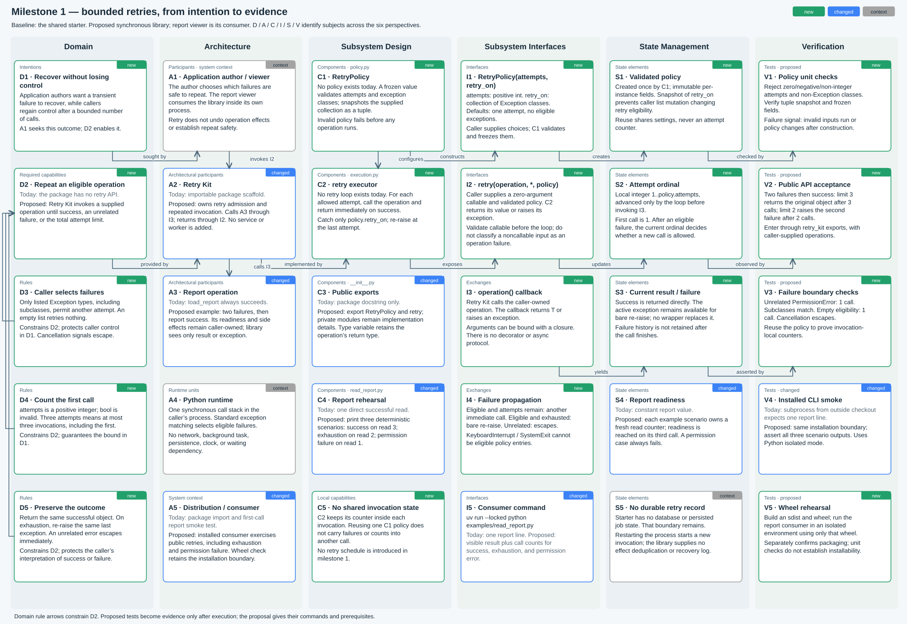
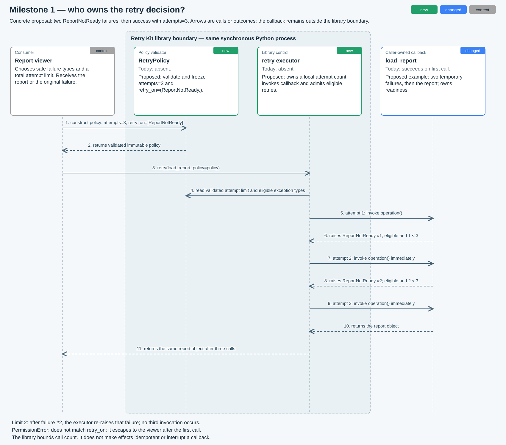
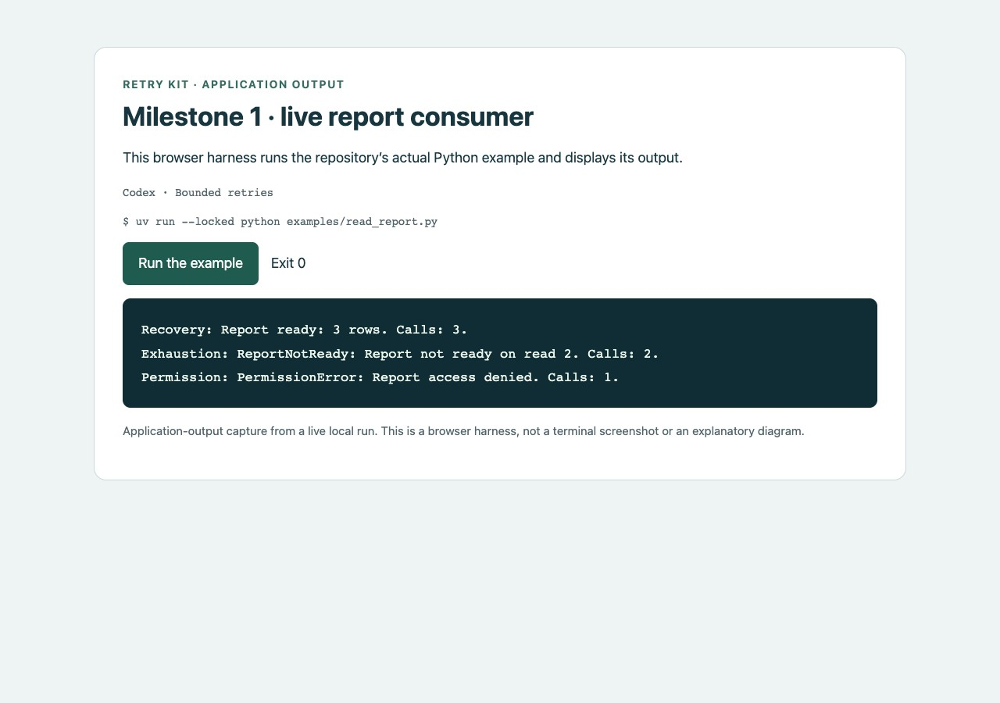

# 01 · Bounded retries

## Prompt

```text
I'd like to build Retry Kit, a small Python library for developers who need to
retry a synchronous operation. For example, a report viewer might retry a read
while a report is still being prepared. A client fetching a record might try
again after a connection drops. I'd like the library to be used for such cases.

Each caller knows the exceptions that determine when it's safe to repeat the
operation and provides a list of such exceptions to the library. The caller
should also choose how many attempts to allow, counting the first call. The
library should retry the operation only if the called function raises one of
those exceptions.

Take the report viewer as an example. Its read function may raise ReportNotReady
if the report is still being prepared. Depending on the time taken to prepare
the report, sometimes the first read succeeds, and sometimes it takes a few
tries. Say the report becomes available between the second and third retries.
With a limit of three attempts, the viewer should get the report eventually.
With a limit of two, it should get the ReportNotReady exception from its
second read. A permission error should reach the viewer immediately.

Give me a design proposal [use $ca-design-proposal].
```

## Recorded proposal

Application authors need Retry Kit to recover from selected transient failures while giving their callers a predictable bound on repeated work.



**Intentions, capabilities, and rules.** The shared starter contains an importable package and a report reader that always succeeds; its one smoke test confirms installation and output. It cannot retry a caller’s operation. The proposed capability lets an application select eligible exception classes and a total attempt count. Three attempts includes the initial call. A success returns the original object immediately; an unrelated failure escapes immediately; exhaustion re-raises the last eligible exception without wrapping it.

The prompt says both “between the second and third retries” and success with three total attempts. I use its explicit three-attempt acceptance outcome: two failed reads, then success on the third read. The original prompt remains unchanged in the recording. This interpretation supplies a coherent example without changing the stated counting rule.



**Architecture and ownership.** Retry Kit will control repeat invocation within the caller’s synchronous Python process. The application author decides which failures make repeating the operation safe; the callback retains responsibility for its effects and its own timeout. The library will neither undo effects nor interrupt a running operation. A `ReportNotReady` subclass qualifies when its parent is selected. An empty eligibility list means no retries. `KeyboardInterrupt` and `SystemExit` remain outside the retryable `Exception` hierarchy.

**Subsystem Design.** The package remains `src/retry_kit`; no runtime dependency is needed.

| Package or module | Components: existing → proposed responsibility |
| --- | --- |
| `policy.py` — new | No policy exists → `RetryPolicy` validates settings and freezes a snapshot of exception classes. |
| `execution.py` — new | No invocation controller exists → `retry` counts calls, matches eligible failures, and returns or propagates the outcome. |
| `__init__.py` — changed | Docstring-only package → exports `RetryPolicy` and `retry`. |
| `examples/read_report.py` — changed | One successful direct read → three public-API scenarios covering success, exhaustion, and permission failure. |

**Subsystem Interfaces.** The proposed entry point is `retry(operation, *, policy=RetryPolicy(...))`. The operation is a zero-argument callable; a closure can bind any required inputs. `RetryPolicy(attempts=3, retry_on=[ReportNotReady])` makes the example’s choices explicit. Defaults are one attempt and no eligible exceptions. Positive integers are accepted for `attempts`; booleans and non-integers are rejected. Each eligibility entry must be an `Exception` subclass. Invalid configuration fails during policy construction, and a noncallable operation fails before retry classification. These defaults keep an omitted setting from silently repeating work.

**State Management.** Policy settings are immutable and the exception collection is copied to a tuple. Mutating the caller’s original list cannot change an in-flight invocation. Each `retry` call owns its attempt ordinal; reusing a policy shares configuration without sharing progress. The current exception stays in the active exception handler, allowing a bare re-raise. No failure history or persistent state is introduced.

**Verification.** With the existing locked development environment, run `uv run --locked python -m pytest -q` for the following groups. All behavioral checks below are proposed; the starter smoke test has already passed.

| Tests and layer | Distinguishing assertion |
| --- | --- |
| Policy unit tests | Invalid limits/types fail; eligibility is snapshotted; frozen settings cannot be reassigned. |
| Public API integration | Two failures then success returns the original object after three calls; a two-attempt policy raises the second failure after exactly two calls. |
| Failure and reuse integration | Unrelated errors, empty eligibility, and cancellation make one call; subclass matching works; two invocations using one policy have independent counters. |
| Installed consumer smoke | A subprocess outside the checkout, using Python isolated mode, prints the three expected scenario results. |

Run `uv run --locked python examples/read_report.py` to observe those scenarios. Build with `uv build`, then run that consumer through `uv run --isolated --no-project --with <wheel> python -I examples/read_report.py` to check installation independently of the editable checkout.

**Authorization.** Your instruction supplies standing authorization to proceed from each completed proposal to implementation. I will implement this proposal now; no separate approval message is claimed.

## Recorded implementation report

Milestone 1 is implemented (`Implement bounded retries for caller-selected failures`).

`RetryPolicy` now validates and freezes the caller’s attempt limit and selected exception types. `retry` runs a synchronous operation with an invocation-local counter, returns its original successful value, and propagates the original unrelated or exhausted failure. The report example exercises all three requested outcomes.

**Verification completed:** `uv run --locked python -m pytest -q` passed **31 tests** on Python 3.12.13 with uv 0.11.16. The suite covers policy validation, frozen configuration and collection snapshots, public success/exhaustion behavior, subclass matching, cancellation, falsey results, policy reuse, and the installed consumer. `uv build` produced an sdist and wheel; the same consumer passed in an isolated environment using that wheel. `git diff --check` passed.

The observed application output was:

```text
Recovery: Report ready: 3 rows. Calls: 3.
Exhaustion: ReportNotReady: Report not ready on read 2. Calls: 2.
Permission: PermissionError: Report access denied. Calls: 1.
```

## Working result



This is a screenshot of a live local browser harness displaying the real Python example’s output. Native terminal capture was unavailable. It is separate from the explanatory proposal diagrams; the harness source and captured text are included in the recording.

There are no runtime dependencies or milestone-specific model artifacts. The library currently retries immediately; it does not wait, enforce an elapsed-time budget, interrupt operations, or make repeated effects safe. Those last two responsibilities remain with the caller. Your standing authorization was used; no separate approval exchange occurred.

[Captured output](assets/01-bounded-retries/output.txt) · [Command and exit status](assets/01-bounded-retries/execution.json)

## Repeat the checks

The proposal started from the shared starter. The build session recorded **31 passing tests**. To repeat the checks at this milestone, check out `Implement milestone 1: retry a caller's operation` from the history of the `codex` branch and run these commands.

```sh
uv run --locked python examples/read_report.py
uv run --locked python -m pytest -q
```

[Original prompt](assets/01-bounded-retries/prompt.txt) · [Saved proposal](assets/01-bounded-retries/proposal.md) · [Saved implementation report](assets/01-bounded-retries/implementation.md)

[Recording index](README.md)
