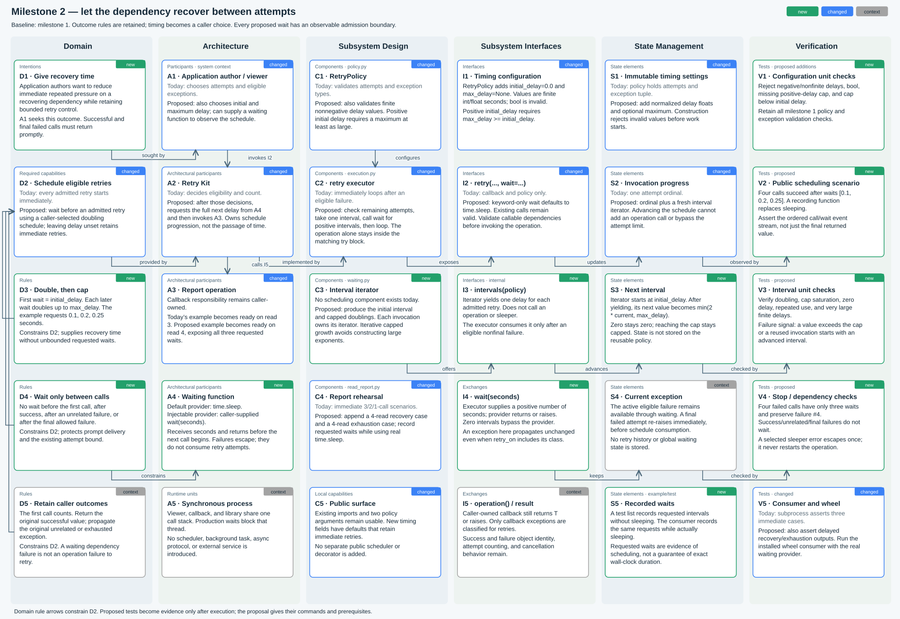
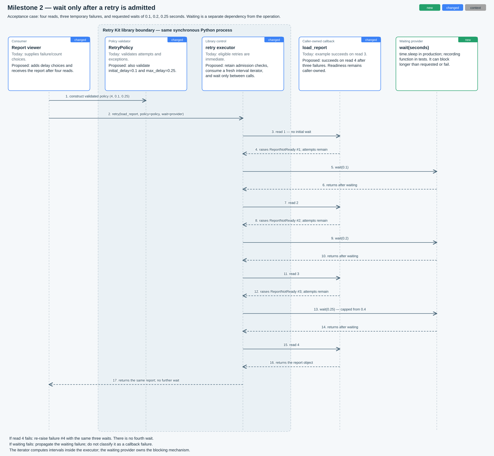
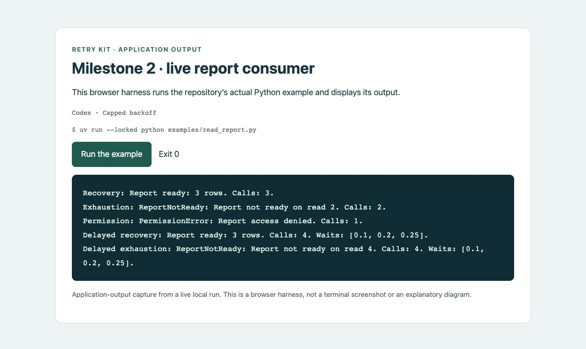

# 02 · Capped backoff

## Prompt

```text
I'd like callers to be able to choose how long Retry Kit waits between
attempts. A client fetching a record might give a busy service time to
recover. The first call should still start right away. If a caller chooses
an initial delay, each successive wait should double up to a maximum the
caller sets. Callers who leave the delay unset should still get immediate
retries.

Take the report viewer as an example. It allows four reads and chooses an
initial delay of 0.1 seconds and a maximum of 0.25 seconds. If the first
three reads raise ReportNotReady, I'd expect the viewer to wait 0.1, 0.2,
and 0.25 seconds before reads two, three, and four. As soon as a read
succeeds, the viewer should get the report. If all four reads fail, it
should get the fourth exception without another wait. I'd like to check
those waits without sleeping in a test.

Give me a design proposal [use $ca-design-proposal].
```

## Recorded proposal

Application authors need to give a recovering dependency time between attempts without delaying an initial call or withholding a completed outcome.



**Intentions and rules.** The baseline is the milestone 1 implementation on `codex`. Its 31 passing tests establish selected-failure retries, the total attempt bound, and original-outcome propagation. Today every eligible retry is immediate. The change adds an initial delay that doubles up to a caller-selected cap. With four attempts, initial delay `0.1`, and cap `0.25`, the requested waits will be `[0.1, 0.2, 0.25]`. The first call still starts immediately. Success, an unrelated error, or exhaustion returns control without another wait.



**Architecture.** Retry Kit continues to own admission and invocation in the caller’s synchronous process. A new waiting dependency supplies the blocking mechanism: `time.sleep` by default, or a caller-provided function for tests. The executor decides whether another call is allowed before consuming an interval or invoking that dependency. Only the operation is inside the exception-matching boundary. If the waiting function raises an exception that also appears in `retry_on`, that dependency failure still escapes; it must not restart the operation.

**Subsystem Design.** The existing package is extended without new runtime dependencies.

| Package or module | Components: existing → proposed responsibility |
| --- | --- |
| `policy.py` — changed | Validate failure/count choices → additionally validate and normalize delay settings. |
| `waiting.py` — new | No scheduling owner → a pure `intervals(policy)` iterator yields capped doubling intervals. |
| `execution.py` — changed | Repeat immediately → after an eligible nonfinal failure, request the next positive interval and then repeat. |
| `examples/read_report.py` — changed | Three immediate scenarios → retain them and append delayed recovery and exhaustion scenarios with recorded real waits. |

**Subsystem Interfaces and choices.** `RetryPolicy` gains `initial_delay=0.0` and `max_delay=None`; `retry` gains keyword-only `wait=time.sleep`. Existing callers retain immediate retries. Delays accept finite nonnegative integer or floating-point seconds; booleans are rejected. A positive initial delay requires a finite cap at least as large. For `initial_delay=0.5, max_delay=0.25`, silently clamping would make the first wait `0.25`; I propose rejecting that conflicting configuration instead, so the initial setting retains its literal meaning. A missing cap with a positive delay is also rejected. When the initial delay is zero, the waiting function is not called, including when a cap alone is supplied.

**State Management.** The immutable policy holds normalized timing choices, while a fresh interval iterator belongs to each `retry` invocation. The iterator starts from the initial delay and advances with capped multiplication; it does not own the operation, sleeper, or attempt count. Reusing a policy must restart the schedule. The active operation exception remains available through the wait. No mutable schedule is stored globally or on the reusable policy.

**Verification.** Run the complete suite with `uv run --locked python -m pytest -q`. The following new checks use recording functions rather than real sleeping; the installed-consumer smoke also exercises the actual waiting provider.

| Tests and layer | Expected observation |
| --- | --- |
| Policy and interval unit tests | Invalid or nonfinite values fail; zero remains zero; growth reaches and stays at the cap, including very large finite values. |
| Public API integration | Ordered events are call 1, wait 0.1, call 2, wait 0.2, call 3, wait 0.25, call 4; success returns the original object. |
| Stop-condition integration | Four failures produce three waits and the original fourth exception; immediate success, unrelated failure, and final failure add no wait. |
| Dependency and reuse integration | A sleeper failure escapes after one operation call; reusing a policy restarts its interval sequence. |
| Installed consumer and wheel | The example prints both four-read scenarios and their requested waits; isolated wheel execution produces the same output. |

The manual command remains `uv run --locked python examples/read_report.py`. The new cases use real waits totaling approximately 1.1 seconds across recovery and exhaustion; exact wall-clock duration is not a contract. The proposal adds requested-delay control, not a deadline or a guarantee that the operating system wakes at an exact instant.

**Authorization.** I will implement this proposal under your standing authorization and record the actual verification results before advancing to milestone 3.

## Recorded implementation report

Milestone 2 is implemented (`Add capped delays and an injectable waiting function`).

`RetryPolicy` now accepts validated `initial_delay` and `max_delay` settings. A fresh interval iterator supplies capped doubling delays for each invocation. `retry` requests a positive wait only after an eligible failure with attempts remaining. The default waiting function is `time.sleep`; callers can inject a recording function. A waiting-function failure propagates without being retried as an operation failure.

**Verification completed:** the full suite passed **63 tests** using `uv run --locked python -m pytest -q`, including every milestone 1 test. New checks cover the ordered call/wait sequence, exhaustion without a trailing wait, zero-delay compatibility, policy reuse, nonfinite and conflicting settings, and caps at both tiny and very large floating-point values. The installed consumer used real sleeping. Source distribution and wheel builds passed, and the isolated wheel consumer reproduced the same results. `git diff --check` passed.

The two new application outcomes were:

```text
Delayed recovery: Report ready: 3 rows. Calls: 4. Waits: [0.1, 0.2, 0.25].
Delayed exhaustion: ReportNotReady: Report not ready on read 4. Calls: 4. Waits: [0.1, 0.2, 0.25].
```

## Working result



The screenshot records actual consumer execution, separately from the explanatory diagrams. The recording also retains the complete output as text. There are no added runtime dependencies. These waits are requested intervals; actual sleep may take longer. No elapsed-time limit exists yet. The implementation followed the presented proposal under your standing authorization.

[Captured output](assets/02-capped-backoff/output.txt) · [Command and exit status](assets/02-capped-backoff/execution.json)

## Repeat the checks

The proposal started from [milestone 1](01-bounded-retries.md). The build session recorded **63 passing tests**. To repeat the checks at this milestone, check out `Implement milestone 2: let callers choose how long to wait` from the history of the `codex` branch and run these commands.

```sh
uv run --locked python examples/read_report.py
uv run --locked python -m pytest -q
```

[Original prompt](assets/02-capped-backoff/prompt.txt) · [Saved proposal](assets/02-capped-backoff/proposal.md) · [Saved implementation report](assets/02-capped-backoff/implementation.md)

[Recording index](README.md) · [Previous milestone](01-bounded-retries.md)
