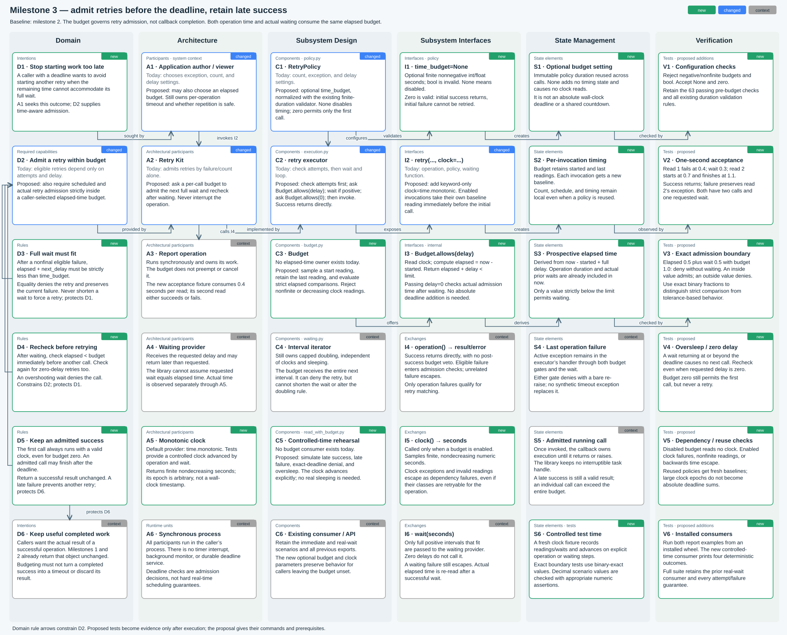
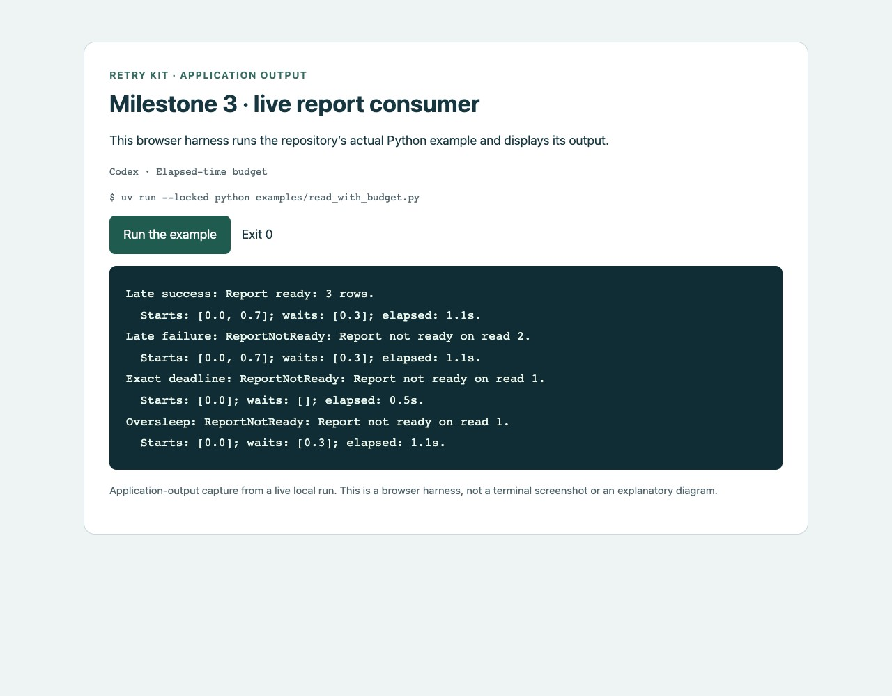

# 03 · Elapsed-time budget

## Prompt

```text
I'd like callers who have a deadline to be able to set a time budget for
starting retries. Both the operation and the waits use up that budget. If the
full wait would put the next retry at or past the deadline, the library should
raise the last exception without waiting, even if the caller has attempts
left. A wait can also take longer than requested, so the library should
check that there's still time just before starting a retry.

Take the report viewer as an example. It has a one-second budget and waits
0.3 seconds between reads. Suppose its first read takes 0.4 seconds and
raises ReportNotReady. The second read starts at 0.7 seconds and finishes
at 1.1 seconds. If the report is ready then, the viewer should get it. If
it's still being prepared, the viewer should get the ReportNotReady exception
from that second read without another wait. I'd like to check both outcomes
with a clock we can control.

Give me a design proposal [use $ca-design-proposal].
```

## Recorded proposal

Callers with deadlines need Retry Kit to stop admitting retries when time is spent while retaining a successful result from work already admitted.



**Intentions and rules.** This proposal starts from the milestone 2 implementation on `codex`, with capped backoff and 63 passing tests. Today attempts and selected failures bound retry admission, but operation duration and oversleeping cannot stop another call. The new budget will cover both operation time and actual waiting. After an eligible failure with attempts remaining, the full next wait must put the prospective retry strictly before the deadline. Equality denies admission. A wait that does not fit will be skipped, never shortened.

The second intention is to preserve useful completed work. A call admitted before the deadline can finish afterward, and its successful result must still return. This is an admission budget, not a timeout that interrupts a running callback.


**Architecture and decision order.** The executor retains control of attempt admission; a new internal `Budget` owns elapsed-time observation. Its clock defaults to `time.monotonic`, with a caller-supplied clock for controlled tests. After a selected failure, the executor checks the attempt limit first, asks whether the complete next interval fits, waits if that interval is positive, and then asks whether time remains immediately before retrying. The final check also runs for zero-delay retries. Only callback exceptions enter retry classification. Clock or waiting failures propagate as dependency failures even when their types appear in `retry_on`.

For the prompt’s case, the first read starts at `0.0` and fails at `0.4`. A `0.3` wait fits; the second read is admitted at `0.7`. A success at `1.1` returns unchanged. If that read instead fails, no further wait fits and its exception is re-raised. If the first wait overshoots to `1.0` or later, the second read never starts and the first exception is preserved.

**Subsystem Design.** The interval calculation remains unchanged; timing is a separate responsibility.

| Package or module | Components: existing → proposed responsibility |
| --- | --- |
| `policy.py` — changed | Validates attempts and waits → also normalizes an optional finite elapsed budget. |
| `budget.py` — new | No elapsed-time owner → `Budget` samples the start, validates clock readings, and makes strict admission comparisons. |
| `execution.py` — changed | Count check followed by waiting → count check, prospective-time gate, waiting, actual-time gate, then retry. |
| `waiting.py` — context | Keeps the existing capped interval sequence; budget denial cannot shorten an interval. |
| `examples/read_with_budget.py` — new | Adds deterministic late-success, late-failure, equality, and oversleep rehearsals using controlled time. |

**Subsystem Interfaces.** `RetryPolicy` gains `time_budget=None`; `retry` gains keyword-only `clock=time.monotonic`. `None` disables timing completely, including clock reads. Zero is valid and permits only the initial call: a success returns, while a failure cannot be retried. Negative, nonfinite, boolean, or nonnumeric durations are rejected before operation execution. A clock returns finite, nondecreasing numeric seconds from an arbitrary epoch. A noncallable clock or invalid reading fails when timing is enabled; disabled timing does not depend on that provider. Existing calls and real-wait examples retain their behavior.

**State Management.** Each enabled invocation samples a fresh baseline immediately before its initial operation. The budget retains that baseline and its last observed reading; the policy holds only the immutable duration. Comparisons use `now - started + delay < limit`, avoiding an absolute deadline sum at a potentially large clock epoch. The post-wait check uses zero delay. A backwards or nonfinite clock reading raises a dependency error rather than silently admitting work. The original eligible exception remains active through both gates for bare re-raising. No check after a successful return can discard that value.

**Verification.** Run `uv run --locked python -m pytest -q` for the complete suite. Budget checks use a controlled clock and recorded waits; the retained consumer smoke still exercises real sleeping.

| Tests and layer | Expected observation |
| --- | --- |
| Policy / budget unit checks | Accept `None` and zero; reject invalid durations; enforce strict comparison and reject invalid or decreasing readings. |
| Public acceptance integration | Both one-second scenarios make two calls and request one `0.3` wait; success returns at `1.1`, failure preserves the second exception. |
| Boundary integration | Exact `0.5 + 0.5 == 1.0` denies without waiting; an inside value admits; oversleeping and zero-delay expiry prevent another call. |
| Compatibility / dependency integration | Disabled timing reads no clock; limits still take precedence; policy reuse resets the baseline; clock and sleeper failures escape. |
| Installed consumers / wheel | Both example scripts run from an installed wheel; the new script prints four deterministic outcomes without sleeping. |

Binary-exact values establish equality boundaries; decimal scenario times will use appropriate approximate assertions. Clock precision and scheduling overhead limit actual start-time precision. The library cannot guarantee a hard wall-clock deadline or stop an operation already running; callers must supply any per-attempt timeout.

**Authorization.** I will implement this proposal using your standing authorization, verify it, and record the actual results before assembling the offline walkthrough.

## Recorded implementation report

Milestone 3 is implemented (`Gate retry admission with elapsed-time budgets`).

The optional `time_budget` now counts operation time and actual waiting. A per-invocation `Budget` observes a monotonic clock; the executor first enforces the attempt limit, then checks whether the complete next wait fits, and checks again immediately before retrying. Either time gate preserves the active operation failure. Success returns directly, including after the deadline. Disabled budgets do not read the clock.

**Verification completed:** the full suite passed **107 tests** using `uv run --locked python -m pytest -q`. This includes the earlier 63 tests and new acceptance, exact-boundary, oversleep, zero-delay, zero-budget, clock-validation, dependency-failure, policy-reuse, large-epoch, and default-monotonic checks. Both example scripts ran against the built wheel in isolated environments. Source distribution and wheel builds and `git diff --check` passed.

The controlled-time application produced:

```text
Late success: Report ready: 3 rows.
  Starts: [0.0, 0.7]; waits: [0.3]; elapsed: 1.1s.
Late failure: ReportNotReady: Report not ready on read 2.
  Starts: [0.0, 0.7]; waits: [0.3]; elapsed: 1.1s.
Exact deadline: ReportNotReady: Report not ready on read 1.
  Starts: [0.0]; waits: []; elapsed: 0.5s.
Oversleep: ReportNotReady: Report not ready on read 1.
  Starts: [0.0]; waits: [0.3]; elapsed: 1.1s.
```

## Working result



This screenshot shows actual execution of the controlled-time example. Its simulated elapsed times are not wall-clock measurements. The explanatory diagrams remain separate, and the complete captured output is available as text.

The implementation follows the proposal under your standing authorization. No runtime dependencies or model artifacts were added. The budget governs admission at observed clock readings; it cannot interrupt a running operation, guarantee a hard real-time start instant, or make repeated side effects safe. The caller still owns those concerns.

[Captured output](assets/03-elapsed-budget/output.txt) · [Command and exit status](assets/03-elapsed-budget/execution.json)

## Repeat the checks

The proposal started from [milestone 2](02-capped-backoff.md). The build session recorded **107 passing tests**. To repeat the checks at this milestone, check out `Implement milestone 3: decide whether there's time for another attempt` from the history of the `codex` branch and run these commands.

```sh
uv run --locked python examples/read_with_budget.py
uv run --locked python -m pytest -q
```

[Original prompt](assets/03-elapsed-budget/prompt.txt) · [Saved proposal](assets/03-elapsed-budget/proposal.md) · [Saved implementation report](assets/03-elapsed-budget/implementation.md)

[Recording index](README.md) · [Previous milestone](02-capped-backoff.md)
