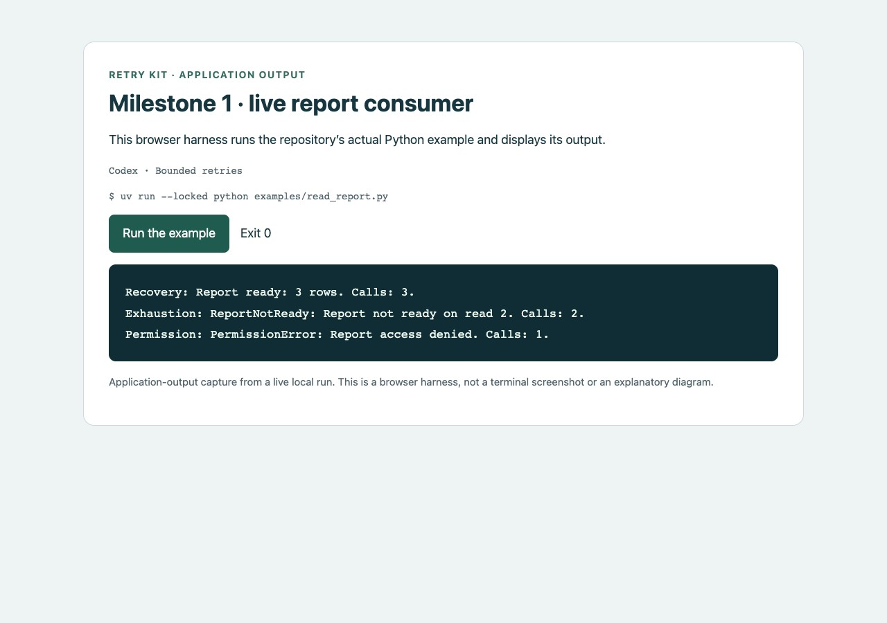

Milestone 1 is implemented (`Implement bounded retries for caller-selected failures`).

`RetryPolicy` now validates and freezes the caller’s attempt limit and selected exception types. `retry` runs a synchronous operation with an invocation-local counter, returns its original successful value, and propagates the original unrelated or exhausted failure. The report example exercises all three requested outcomes.

**Verification completed:** `uv run --locked python -m pytest -q` passed **31 tests** on Python 3.12.13 with uv 0.11.16. The suite covers policy validation, frozen configuration and collection snapshots, public success/exhaustion behavior, subclass matching, cancellation, falsey results, policy reuse, and the installed consumer. `uv build` produced an sdist and wheel; the same consumer passed in an isolated environment using that wheel. `git diff --check` passed.

The observed application output was:

```text
Recovery: Report ready: 3 rows. Calls: 3.
Exhaustion: ReportNotReady: Report not ready on read 2. Calls: 2.
Permission: PermissionError: Report access denied. Calls: 1.
```



This is a screenshot of a live local browser harness displaying the real Python example’s output. Native terminal capture was unavailable. It is separate from the explanatory proposal diagrams; the harness source and captured text are included in the recording.

There are no runtime dependencies or milestone-specific model artifacts. The library currently retries immediately; it does not wait, enforce an elapsed-time budget, interrupt operations, or make repeated effects safe. Those last two responsibilities remain with the caller. Your standing authorization was used; no separate approval exchange occurred.
