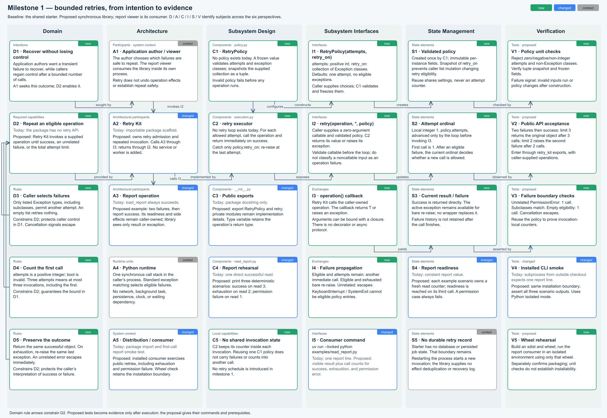
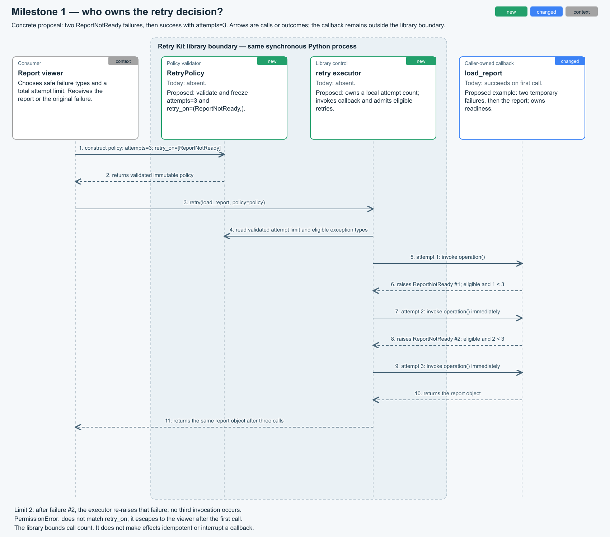

Application authors need Retry Kit to recover from selected transient failures while giving their callers a predictable bound on repeated work.

**Intentions, capabilities, and rules.** The shared starter contains an importable package and a report reader that always succeeds; its one smoke test confirms installation and output. It cannot retry a caller’s operation. The proposed capability lets an application select eligible exception classes and a total attempt count. Three attempts includes the initial call. A success returns the original object immediately; an unrelated failure escapes immediately; exhaustion re-raises the last eligible exception without wrapping it.

The prompt says both “between the second and third retries” and success with three total attempts. I use its explicit three-attempt acceptance outcome: two failed reads, then success on the third read. The original prompt remains unchanged in the recording. This interpretation supplies a coherent example without changing the stated counting rule.

**Architecture and ownership.** Retry Kit will control repeat invocation within the caller’s synchronous Python process. The application author decides which failures make repeating the operation safe; the callback retains responsibility for its effects and its own timeout. The library will neither undo effects nor interrupt a running operation. A `ReportNotReady` subclass qualifies when its parent is selected. An empty eligibility list means no retries. `KeyboardInterrupt` and `SystemExit` remain outside the retryable `Exception` hierarchy.

**Subsystem Design.** The package remains `src/retry_kit`; no runtime dependency is needed.

| Package or module | Components: existing → proposed responsibility |
| --- | --- |
| `policy.py` — new | No policy exists → `RetryPolicy` validates settings and freezes a snapshot of exception classes. |
| `execution.py` — new | No invocation controller exists → `retry` counts calls, matches eligible failures, and returns or propagates the outcome. |
| `__init__.py` — changed | Docstring-only package → exports `RetryPolicy` and `retry`. |
| `examples/read_report.py` — changed | One successful direct read → three public-API scenarios covering success, exhaustion, and permission failure. |

**Subsystem Interfaces.** The proposed entry point is `retry(operation, *, policy=RetryPolicy(...))`. The operation is a zero-argument callable; a closure can bind any required inputs. `RetryPolicy(attempts=3, retry_on=[ReportNotReady])` makes the example’s choices explicit. Defaults are one attempt and no eligible exceptions. Positive integers are accepted for `attempts`; booleans and non-integers are rejected. Each eligibility entry must be an `Exception` subclass. Invalid configuration fails during policy construction, and a noncallable operation fails before retry classification. These defaults keep an omitted setting from silently repeating work.

**State Management.** Policy settings are immutable and the exception collection is copied to a tuple. Mutating the caller’s original list cannot change an in-flight invocation. Each `retry` call owns its attempt ordinal; reusing a policy shares configuration without sharing progress. The current exception stays in the active exception handler, allowing a bare re-raise. No failure history or persistent state is introduced.

**Verification.** With the existing locked development environment, run `uv run --locked python -m pytest -q` for the following groups. All behavioral checks below are proposed; the starter smoke test has already passed.

| Tests and layer | Distinguishing assertion |
| --- | --- |
| Policy unit tests | Invalid limits/types fail; eligibility is snapshotted; frozen settings cannot be reassigned. |
| Public API integration | Two failures then success returns the original object after three calls; a two-attempt policy raises the second failure after exactly two calls. |
| Failure and reuse integration | Unrelated errors, empty eligibility, and cancellation make one call; subclass matching works; two invocations using one policy have independent counters. |
| Installed consumer smoke | A subprocess outside the checkout, using Python isolated mode, prints the three expected scenario results. |

Run `uv run --locked python examples/read_report.py` to observe those scenarios. Build with `uv build`, then run that consumer through `uv run --isolated --no-project --with <wheel> python -I examples/read_report.py` to check installation independently of the editable checkout.

**Authorization.** Your instruction supplies standing authorization to proceed from each completed proposal to implementation. I will implement this proposal now; no separate approval message is claimed.
