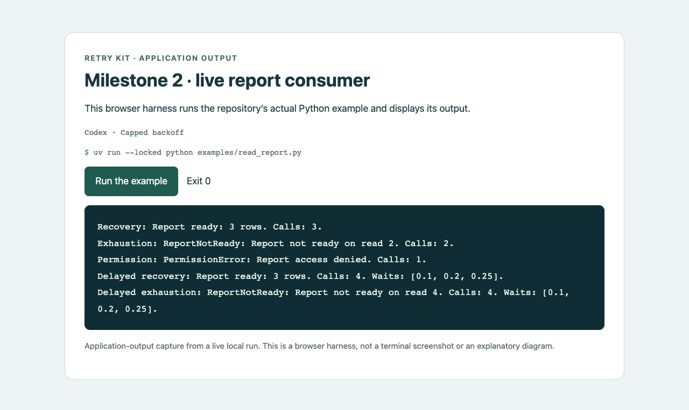

Milestone 2 is implemented (`Add capped delays and an injectable waiting function`).

`RetryPolicy` now accepts validated `initial_delay` and `max_delay` settings. A fresh interval iterator supplies capped doubling delays for each invocation. `retry` requests a positive wait only after an eligible failure with attempts remaining. The default waiting function is `time.sleep`; callers can inject a recording function. A waiting-function failure propagates without being retried as an operation failure.

**Verification completed:** the full suite passed **63 tests** using `uv run --locked python -m pytest -q`, including every milestone 1 test. New checks cover the ordered call/wait sequence, exhaustion without a trailing wait, zero-delay compatibility, policy reuse, nonfinite and conflicting settings, and caps at both tiny and very large floating-point values. The installed consumer used real sleeping. Source distribution and wheel builds passed, and the isolated wheel consumer reproduced the same results. `git diff --check` passed.

The two new application outcomes were:

```text
Delayed recovery: Report ready: 3 rows. Calls: 4. Waits: [0.1, 0.2, 0.25].
Delayed exhaustion: ReportNotReady: Report not ready on read 4. Calls: 4. Waits: [0.1, 0.2, 0.25].
```



The screenshot records actual consumer execution, separately from the explanatory diagrams. The recording also retains the complete output as text. There are no added runtime dependencies. These waits are requested intervals; actual sleep may take longer. No elapsed-time limit exists yet. The implementation followed the presented proposal under your standing authorization.
