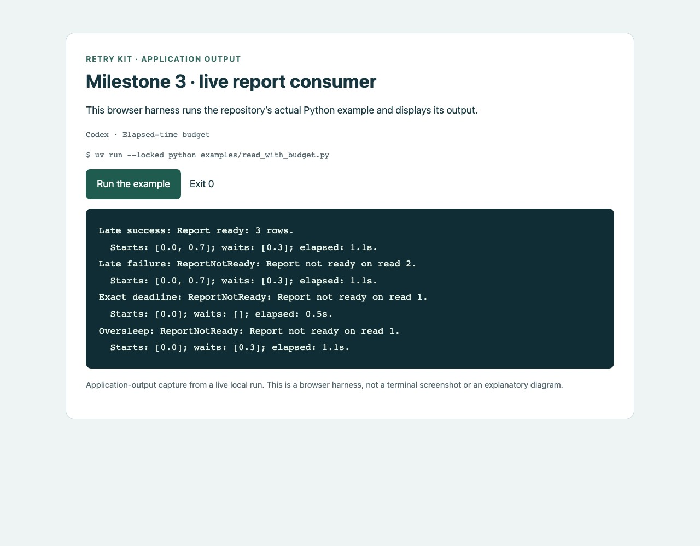

Milestone 3 is implemented (`Gate retry admission with elapsed-time budgets`).

The optional `time_budget` now counts operation time and actual waiting. A per-invocation `Budget` observes a monotonic clock; the executor first enforces the attempt limit, then checks whether the complete next wait fits, and checks again immediately before retrying. Either time gate preserves the active operation failure. Success returns directly, including after the deadline. Disabled budgets do not read the clock.

**Verification completed:** the full suite passed **107 tests** using `uv run --locked python -m pytest -q`. This includes the earlier 63 tests and new acceptance, exact-boundary, oversleep, zero-delay, zero-budget, clock-validation, dependency-failure, policy-reuse, large-epoch, and default-monotonic checks. Both example scripts ran against the built wheel in isolated environments. Source distribution and wheel builds and `git diff --check` passed.

The controlled-time application produced:

```text
Late success: Report ready: 3 rows.
  Starts: [0.0, 0.7]; waits: [0.3]; elapsed: 1.1s.
Late failure: ReportNotReady: Report not ready on read 2.
  Starts: [0.0, 0.7]; waits: [0.3]; elapsed: 1.1s.
Exact deadline: ReportNotReady: Report not ready on read 1.
  Starts: [0.0]; waits: []; elapsed: 0.5s.
Oversleep: ReportNotReady: Report not ready on read 1.
  Starts: [0.0]; waits: [0.3]; elapsed: 1.1s.
```



This screenshot shows actual execution of the controlled-time example. Its simulated elapsed times are not wall-clock measurements. The explanatory diagrams remain separate, and the complete captured output is available as text.

The implementation follows the proposal under your standing authorization. No runtime dependencies or model artifacts were added. The budget governs admission at observed clock readings; it cannot interrupt a running operation, guarantee a hard real-time start instant, or make repeated side effects safe. The caller still owns those concerns.
